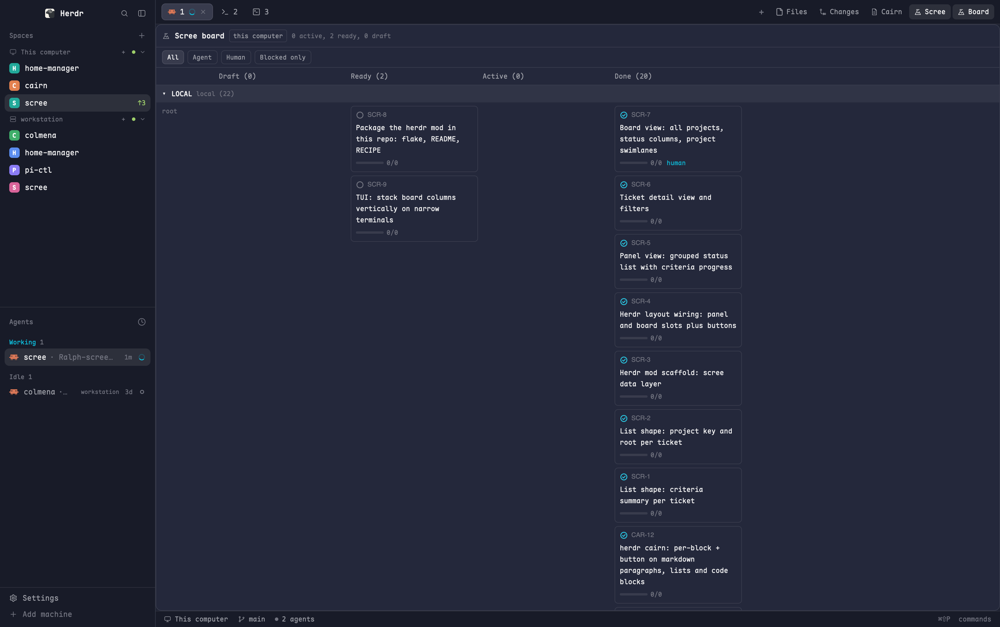

# Scree for Herdr

A [Herdr](https://herdr.dev) mod that shows scree tickets inside the window. One mod, two views chosen by the layout block's `props.view`:

- **panel**: a side panel of the focused space's project, grouped Active, Ready, Draft and Done (plus Abandoned on demand), with criteria progress bars and a ticket detail view.
- **board**: a full-window board of every Project and Worktree, with Draft, Ready, Active and Done columns (plus Abandoned on demand) and one swimlane per project.



[`scree/`](scree/) is the shareable folder: `mods/scree/`, the [`RECIPE.md`](scree/RECIPE.md) a build is written from, and `preview.png`.

## What it needs

- `scree` (this repo's binary). Reads run `scree --json list` (open tickets, done tickets, or `--all-projects` for the board) and `scree --json show ID` in the space's folder, so scree's project scoping decides which tickets show. Writes are the seven status commands - `ready`, `start`, `release`, `draft`, `done`, `abandon`, `reopen` - from a ticket's status menu, `edit` from the detail's Edit form, `comment edit` from the Edit control on a comment, and `add` from the create form, each run as `scree --json --role human <verb> ...` in the Project root the ticket lives in (for `add`, the folder you chose to file into). An argv the mod did not build itself is refused before it reaches the binary. "tui" opens `scree tui` in a new pane.
- `mod.json` sets `"focusable": true`.
- A layout with the two blocks. For the panel, add a child to the stack `panel-body` inside the column `panel`; for the board, add a sibling of `work-body` in the stack `work-area`:

  ```json
  { "id": "scree", "type": "block", "content": { "mod": "scree", "props": { "view": "panel" } } }
  { "id": "scree-board", "type": "block", "content": { "mod": "scree", "props": { "view": "board" } } }
  ```

  Then tab-bar buttons that show them:

  ```js
  // Scree panel button
  run("layout.select", { stack: "panel-body", child: "scree" });
  run("layout.show", { id: "panel" });
  // Board button (toggles back to the normal work area)
  run("layout.select", { stack: "work-area", child: "scree-board" }); // or child "work-body" to leave
  ```

  Herdr's shipped layouts and the `tabs` mod are read-only, so clone them (`herdr-app do layout.clone`, `herdr-app do mod.clone`) and edit the clones. The `tabs` mod's `panelButton("changes", ...)` line is the one to copy for a Scree button.

## Install by hand

Copy `scree/mods/scree/` to `~/.config/herdr-app/mods/scree/` and run `herdr-app check ~/.config/herdr-app/mods/scree`. The mod looks for `scree` on `PATH`.

## Install with nix

The flake exports `packages.<system>.herdr-mod`: the mod laid out as a Herdr home's `mods/` folder, with its scree binary pinned to the same flake's `scree` package.

```nix
# inputs.scree.url = "github:jeffutter/scree";
home.file.".config/herdr-app/mods/scree" = {
  source = "${inputs.scree.packages.${pkgs.system}.herdr-mod}/mods/scree";
  recursive = true; # Herdr writes jsconfig.json and .d.ts files into mod folders
};
```

Link the folder per file (`recursive = true`) so Herdr can write its own files beside the mod's. `nix build .#herdr-mod` also runs the mod's node test (`scree.test.mjs`).

## Use

- Click the Scree button for the panel. The panel header shows the Project and Worktree it is scoped to next to "Scree". Section headers fold; "This worktree" / "All worktrees" switches scope; the chips filter by All, Agent, Human and Blocked only. "Show abandoned" adds an Abandoned section (panel) or column (board), hidden by default and not counted in the headline; it costs one extra list call per poll, and abandoned tickets of removed worktrees stay archived and hidden. With it on, an abandoned ticket's status menu offers reopen. Click a row for the ticket detail, "Back" returns.
- Click the Board button for the board. A project whose visible tickets are all done starts folded; one with any open ticket starts expanded. Clicking a project header pins your choice either way, and it survives polls and restarts. Click a card to open its detail, "+N more" to expand a long cell.
- Click a ticket's status mark - a panel row, a board card, or the detail's status chip - for its status menu, which lists the statuses scree can move it to from where it stands. Choosing one runs the change and refetches at once, so the card moves without waiting for the next poll; Escape or a click anywhere else closes the menu. Abandon records a fixed reason ("abandoned from the scree mod"), and a refusal shows scree's own message in a strip under the header.
- Click Edit in a ticket's detail to change its title, description, plan or For; Save runs `scree edit` with only what changed.
- Click Edit on a comment in a ticket's detail to change its text in place; Save runs `scree comment edit` and the comment shows "(edited)" afterwards. Only one comment edits at a time; an empty body is refused, and Escape or Cancel discards. This needs a scree that has `comment edit`.
- Click "New" in the panel header, or "New ticket" on a board Project header, to file a ticket: title, description, plan, one acceptance criterion per line, For and Status (draft or ready). The form shows which project it files into; Create opens the new ticket.
- "tui" (panel header) and "Open in scree tui" (detail) open `scree tui` in a new pane on the right, for a space on this machine.
- The mod polls every 3 s; no server is involved.

To run the node test by hand: `node herdr/scree/mods/scree/scree.test.mjs`.
