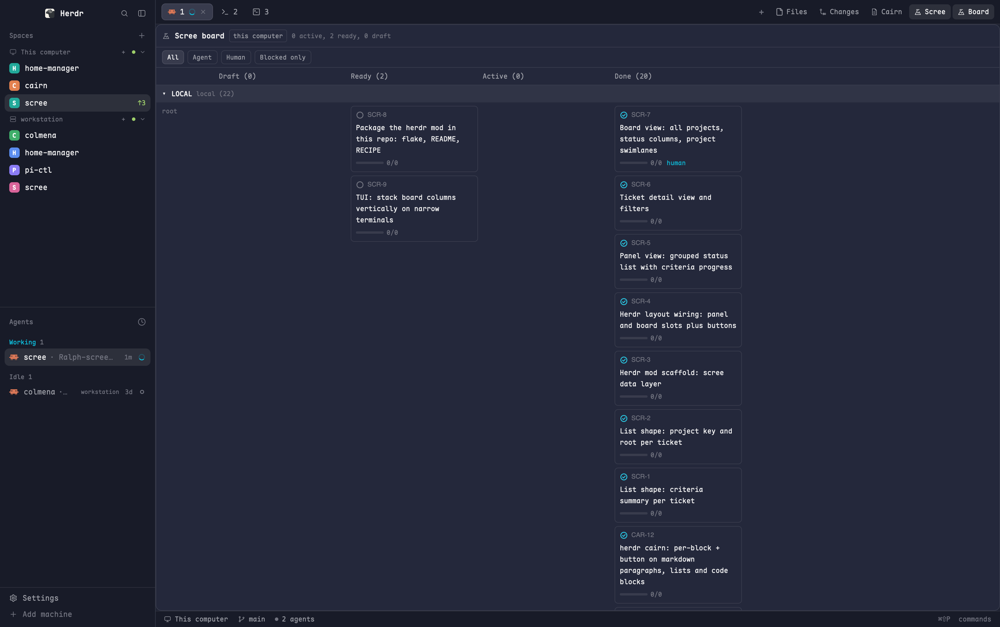

# Scree

A Herdr mod that shows scree tickets: a side panel for the focused space's project and a full-window board of every project. It only reads tickets.

## What you see

Panel: a rounded 10px card, `theme().background`, 1px `border`, 13px text, in the layout's right column beside Files, Changes and Cairn.

- **Header:** scree icon, "Scree", the counts line ("N active, N ready, N draft"), a scope button ("This worktree" or "All worktrees") and a "tui" button.
- **Filter bar:** chips All, Agent, Human, Blocked only.
- **Body:** sections Active, Ready, Draft, Done (Done shows the 5 newest), each with a fold arrow and "Label (count)". Rows: status mark (14px svg), monospace id (11px, dim), title (truncated); second line: 48x4 criteria bar plus "checked/total", then chips in the order blocked, human, "N subtasks", claimer (session or author, cut to 8 chars when longer than 12).
- **Legend:** a bottom strip marking Active, Ready, Draft, Done, Blocked.
- **Detail** (replaces the panel on a row click): header with "Back", id, title and "Open in scree tui"; chips for status, "for human|agent", blocked, claimed; sections Description, Plan (monospace), Criteria with evidence, Comments, Blocked by, Subtasks (the last two are clickable).

Board: header "Scree board", a machine chip ("this computer" or the machine name) and counts; the filter bar; a column header row (Draft, Ready, Active, Done with counts, 220px columns); per project a clickable header (key, root path, count) with one lane per worktree (root checkout first, label is the folder name). Cards show mark, id, title and the same second line. Done shows only the last 7 days.

## How it behaves

- Status marks (`mark-<kind>.svg`, tinted): active `theme().working`, ready `idle`, draft `dim`, done `done`, and any blocked ticket uses the blocked mark in `theme().blocked`. Human tickets get a "human" chip in `working`.
- Polls every 3 s in the active space's folder (focused pane `cwd`, else the space folder) on that space's machine. Changing space or scope parks that context's data and restores it. An open detail reloads on each poll.
- Clicks: row or card opens the detail; section header folds, project header toggles its fold (a stored choice beats the all-done default below); scope button toggles; chips filter; "+N more" expands a cell past 5 cards ("Show less" collapses); "tui" runs `terminal.open` with argv `[scree, "tui"]`, `place: "right"`.
- Fold, scope and filter state survive restarts through `localStorage` (keys `allWorktrees`, `folded`, `boardFolded`, `boardExpanded`, `filterFor`, `blockedOnly`). `boardFolded` holds explicit user choices only: a key present as a boolean wins over the data, a missing key means a project whose visible tickets are all done (`onlyDone` in `boardModel`) starts folded.
- Errors: "scree not found on <machine>" when no binary answers, "Not in a scree project", otherwise scree's message. Empty: "No tickets" or "No tickets match the filters".
- No keys. Agent statuses do not apply.

## Built from

- One mod, `mods/scree/`: `main.js`, `mod.json` = `{ "place": "none", "focusable": true }`, `scree.svg`, `mark-{active,blocked,done,draft,ready}.svg`, `scree.test.mjs`. Imports `View, div, svg` from `gpui-kit`; `v_flex, h_flex` from `gpui-base`; `spaces, panes, focused, exec, theme, run, props` from `herdr`.
- `props.view` is `"panel"` or `"board"`; `init` gets no props for a layout block, so it reads `props()` from `herdr`.
- scree commands, all via `exec(bin, args, {cwd, on, timeout: 15000})`: `--json list [--all-worktrees] --status draft --status ready --status active --limit 200`, `--json list [--all-worktrees] --status done --limit 500`, `--json list --all-projects --status draft --status ready --status active --limit 1000` and `--json list --all-projects --status done --limit 1000` (board, two calls), `--json show ID`. The list shape carries `criteria {checked,total}`, `project {key,root}`, `worktree`, `claimed_by`, `done_at`, `archived_at`.
- The binary is `BINS = ["@scree@", "scree"]`: the flake replaces `@scree@` with a store path; unreplaced it fails and falls back to `scree` on PATH. Write subcommands are refused in `scree()` (`WRITE_COMMANDS`).
- Pure helpers sit between `// --- pure begin ---` and `// --- pure end ---` in `main.js` (grouping, filters, board model, argument builders); `scree.test.mjs` slices that region and tests it with `node`.
- Layout: a block `{ "id": "scree", "content": { "mod": "scree", "props": { "view": "panel" } } }` in the stack `panel-body`; a block `{ "id": "scree-board", ... "props": { "view": "board" } }` in the stack `work-area` next to `work-body`; tab-bar buttons running `layout.select` (and `layout.show {id: "panel"}` for the panel).

## Watch out

- `scree --json list` outside a repo exits 0 with the unscoped project, so "Not in a scree project" appears only when the space has no folder.
- Keep the pure region free of imports and host globals or the test cannot load it.
- Board all-projects needs no repo, so a space without a folder still shows it.
- `tui` is hidden for a space on another machine.
- `herdr-app check` does not exercise the layout or a click; open it in the app.
- Do not write caches under `mods/`: saving there reloads the mod.

## Done when

- `herdr-app check mods/scree` passes and `herdr-app status` shows no errors.
- `node scree.test.mjs` prints `ok`.
- In a repo with tickets, the Scree button opens the panel with the right sections and counts; the scope button changes the list.
- The Board button shows every project with its columns; the project header folds, and a project whose visible tickets are all done starts folded until clicked. The fold toggle's click path (`nextBoardFold`) is covered by `scree.test.mjs`.
- A row click shows the detail with criteria evidence; Back returns.
- "tui" opens a pane running `scree tui`.
- Stopping `scree` from `PATH` shows "scree not found".
